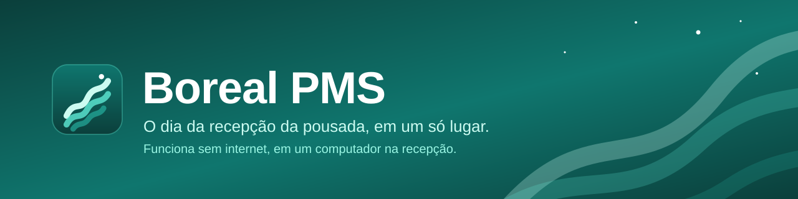
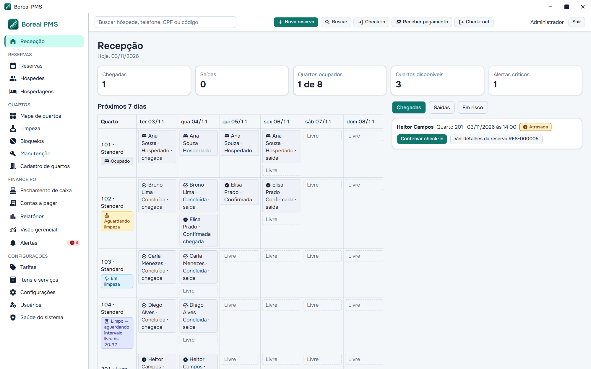
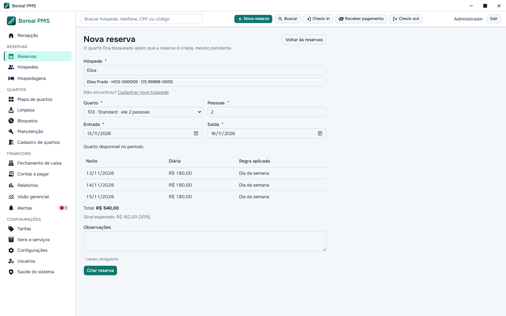
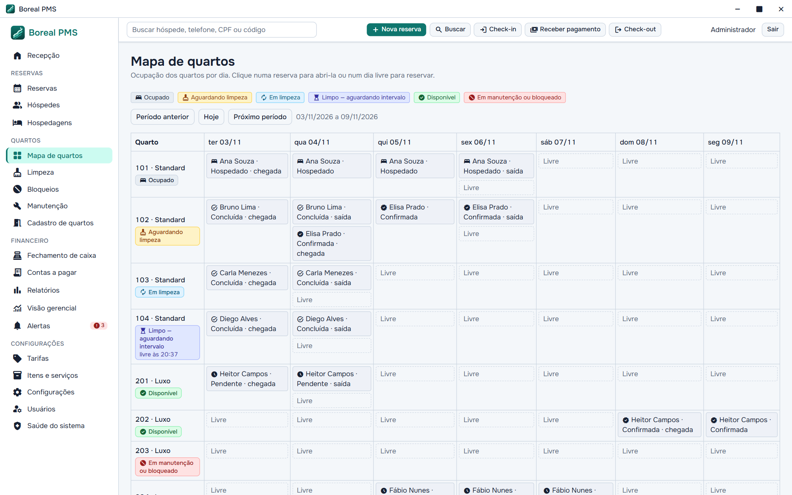
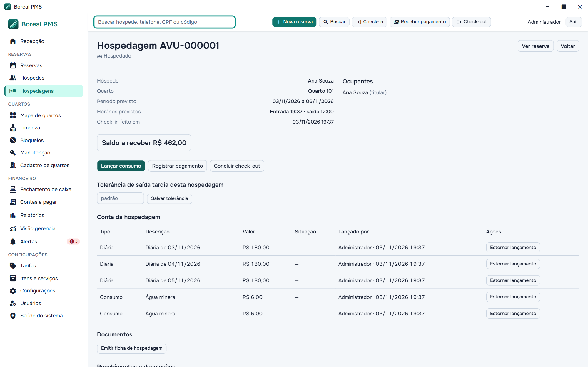
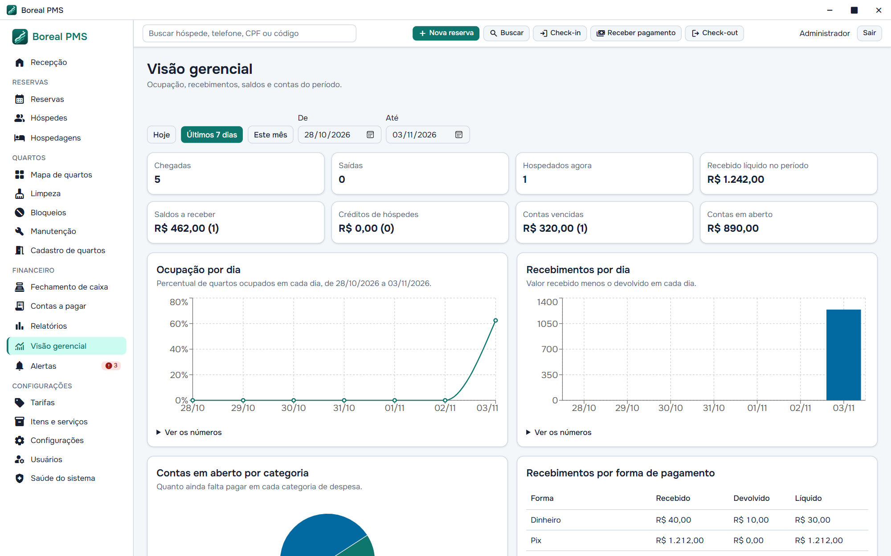

<p align="center">
  
</p>

<p align="center">
  
  
  
  
  
  <br>
  
  
  
  
  
</p>

<p align="center">
  <a href="docs/como-funciona.md"><strong>Como funciona</strong></a> ·
  <a href="#rodar-o-projeto"><strong>Rodar o projeto</strong></a> ·
  <a href="docs/usuario/README.md"><strong>Manual do usuário</strong></a> ·
  <a href="docs/desenvolvimento/README.md"><strong>Documentação técnica</strong></a>
</p>

O **Boreal** é um sistema de gestão (PMS) para a operação interna de uma única pousada. Ele reúne reservas, hospedagens, limpeza, financeiro e relatórios em um aplicativo desktop que roda em um computador na recepção, sem depender de internet.



## Um dia na recepção

O Boreal foi desenhado em torno do dia de trabalho, não de cadastros. Cada etapa abaixo tem detalhes e imagens em **[Como o Boreal funciona](docs/como-funciona.md)**.

| Etapa | O que acontece | Regra que protege a pousada |
|---|---|---|
| **Reservar** | Disponibilidade e preço aparecem noite a noite, enquanto se preenche. | O quarto fica bloqueado desde a reserva pendente, e o preço combinado não muda depois. |
| **Receber** | `Confirmar check-in` confere ocupantes e lança as diárias na conta. | Quarto sujo ou antes do intervalo de limpeza é recusado. |
| **Hospedar** | Consumos, ajustes e pagamentos, inclusive divididos em várias formas. | Nada é editado: corrige-se com estorno, e o histórico fica. |
| **Liberar o quarto** | O check-out gera o demonstrativo e o quarto entra na fila de limpeza. | O tempo sozinho nunca libera um quarto sujo ou em manutenção. |
| **Fechar o dia** | A recepção confere cada forma de pagamento contra o valor esperado. | Diferença não impede o fechamento, mas exige justificativa. |

<table>
  <tr>
    <td width="50%"></td>
    <td width="50%"></td>
  </tr>
  <tr>
    <td align="center"><strong>Reservas</strong> com preço noite a noite</td>
    <td align="center"><strong>Mapa de quartos</strong> com estado de cada quarto</td>
  </tr>
  <tr>
    <td></td>
    <td></td>
  </tr>
  <tr>
    <td align="center"><strong>Conta do hóspede</strong> como livro de lançamentos</td>
    <td align="center"><strong>Visão gerencial</strong> com números e gráficos</td>
  </tr>
</table>

## O que já existe

- **Recepção:** resumo do dia, chegadas, saídas, riscos e agenda de 7 dias, com painel lateral que preserva o contexto.
- **Reservas e tarifas:** disponibilidade, preço por dia da semana, temporada e feriado, sinal, alteração com prévia e cancelamento.
- **Hospedagem:** check-in, hospedagem sem reserva, conta do hóspede, check-out e saída tardia.
- **Quartos:** seis estados calculados, fila de limpeza, bloqueios e ordens de manutenção.
- **Financeiro:** pagamentos divididos, devoluções, contas a pagar e fechamento de caixa.
- **Gestão:** alertas persistentes, busca global, visão gerencial, dez relatórios (com CSV e PDF) e documentos internos versionados.
- **Proteção:** usuários e permissões, auditoria imutável, banco criptografado, backup, restauração e chave de recuperação.

Fora do escopo: integração com bancos, operadoras de cartão ou sistemas fiscais, nuvem, sincronização entre computadores e estoque.

## Situação do projeto

Os marcos 0 a 7 estão implementados, com 1.273 testes automatizados passando em 03/11/2026 (574 de interface e 699 de backend). O próximo é o **Marco 8**: qualidade, empacotamento e implantação. Ainda **não há instalador**, e a execução é pelo ambiente de desenvolvimento.

Alguns valores comerciais, como o sinal de 30% e a política de cancelamento, são **provisórios** e configuráveis enquanto aguardam aprovação da pousada.

## Rodar o projeto

**Pré-requisitos (Windows)**

- [Node.js](https://nodejs.org) 22 ou superior
- [Rust](https://rustup.rs) estável, com as ferramentas de build do Visual Studio (C++)
- WebView2, já incluído no Windows 11 e nas versões recentes do Windows 10
- **Strawberry Perl** (`winget install StrawberryPerl.StrawberryPerl`), necessário para compilar o OpenSSL usado pelo SQLCipher. Deixe `C:\Strawberry\perl\bin` antes do Perl do Git no `PATH`.

**Instalar e executar**

```bash
npm install --legacy-peer-deps
npm run tauri dev
```

O `--legacy-peer-deps` evita um conflito de dependência opcional do `@hookform/resolvers`. Na primeira execução, o sistema pede a criação do administrador.

**Ver o sistema com dados de exemplo**

```bash
BOREAL_SEED_ADMIN_PASSWORD='uma-senha-de-dev' \
  cargo run --manifest-path src-tauri/Cargo.toml --example seed --features dev-seed -- --db <caminho/boreal.db>
```

Use um banco de desenvolvimento, nunca um com dados reais. O [guia do seed](docs/desenvolvimento/seed.md) explica o cenário criado e como abri-lo no aplicativo.

**Testes e verificações**

```bash
npm test                                              # interface
npm run build                                         # tipos e build da interface
cargo test --manifest-path src-tauri/Cargo.toml       # backend
cargo clippy --manifest-path src-tauri/Cargo.toml --all-targets -- -D warnings
```

## Como é construído

A interface nunca é a fonte de verdade: disponibilidade, valores, permissões e saldos são validados de novo no backend, no momento de gravar.

| Camada | Tecnologias |
|---|---|
| Desktop e backend | Rust, Tauri 2, `rusqlite` com SQLCipher, Argon2id para senhas |
| Interface | React, TypeScript, Vite, Tailwind CSS, shadcn/ui, React Router |
| Dados e formulários | TanStack Query, Zustand, React Hook Form, Zod, date-fns, Recharts |
| Testes | `cargo test`, Vitest e Testing Library |

```text
src/                     interface React (pages, components, stores, lib)
src-tauri/src/
  commands/              comandos Tauri (camada fina, sem regra de negócio)
  services/              regras de negócio e transações
  repositories/          acesso ao SQLite
  domain/                regras puras (estado do quarto, limpeza, backup)
  models/                tipos de domínio
  auth/                  senhas, permissões e sessões
  audit/                 auditoria centralizada
  migrations/            migrações versionadas (sql/)
  db/                    abertura do banco criptografado e cofre da chave
docs/
  como-funciona.md       visão do produto, com imagens
  usuario/               guias para a equipe e roteiro de treinamento
  desenvolvimento/       regras, decisões técnicas e efeitos no banco
  superpowers/plans/     planos de implementação
```

## Segurança

- A interface não acessa o banco: tudo passa por comandos Tauri, e **permissões e validações são aplicadas no backend**.
- O banco é criptografado com SQLCipher. A chave de 256 bits é gerada na primeira execução e fica no cofre de credenciais do sistema operacional, nunca em arquivos.
- Se o banco existir e a chave não estiver disponível, o aplicativo **não recria** o banco: ele pede a [chave de recuperação](docs/usuario/chave-de-recuperacao.md).
- **Atenção:** sem a chave de recuperação e sem este computador, os dados não podem ser recuperados.
- A auditoria é imutável, por gatilhos no banco, e nunca registra senhas.
- Não versione bancos de dados, backups, credenciais ou `.env`. O `.gitignore` já cobre os casos comuns.

Decisões e limites conhecidos estão em [Segurança operacional](docs/desenvolvimento/seguranca-operacional.md) e [Backup, restauração e recuperação](docs/desenvolvimento/backup-e-recuperacao.md).

## Documentação

| Documento | Para quem |
|---|---|
| [Como o Boreal funciona](docs/como-funciona.md) | Quem está chegando ao projeto |
| [Documentação de desenvolvimento](docs/desenvolvimento/README.md) | Quem vai alterar o código |
| [Manual do usuário](docs/usuario/README.md) | A equipe da pousada |
| [Roteiro de treinamento](docs/usuario/roteiro-de-treinamento.md) | Quem vai apresentar o sistema |
| [CHANGELOG](CHANGELOG.md) | Quem quer saber o que mudou |
