# Como o Boreal funciona

O Boreal é o sistema da recepção de uma pousada. Este documento mostra como ele funciona, seguindo um dia de trabalho, do início do turno ao fechamento do caixa. Foi escrito para quem vai desenvolver no projeto e precisa entender o produto antes de abrir o código; os detalhes técnicos ficam para o final.

> [!NOTE]
> Os prints vêm do aplicativo real, rodando com os [dados fictícios do seed](desenvolvimento/seed.md). Nomes, telefones e valores são inventados.

**Neste documento**

- [A ideia em um minuto](#a-ideia-em-um-minuto)
- [O dia de trabalho](#o-dia-de-trabalho)
  1. [Começar o turno](#1-começar-o-turno)
  2. [Reservar um quarto](#2-reservar-um-quarto)
  3. [Receber o hóspede](#3-receber-o-hóspede)
  4. [Durante a estadia](#4-durante-a-estadia)
  5. [Saída do hóspede](#5-saída-do-hóspede)
  6. [Preparar o quarto](#6-preparar-o-quarto)
  7. [Fechar o caixa](#7-fechar-o-caixa)
- [O que acompanha o dia](#o-que-acompanha-o-dia)
- [Proteger os dados](#proteger-os-dados)
- [Como isso se traduz em código](#como-isso-se-traduz-em-código)
- [Onde aprofundar](#onde-aprofundar)

## A ideia em um minuto

Uma pousada pequena funciona com uma pessoa na recepção e um computador. Daí vêm as decisões que moldam todo o produto:

| O que a recepção precisa | Como o Boreal responde |
|---|---|
| Trabalhar mesmo sem internet | Tudo roda e fica salvo no computador da recepção. Não há servidor nem nuvem. |
| Saber o que fazer agora | A tela inicial mostra o dia de hoje: quem chega, quem sai e o que está em risco. |
| Não perder o que estava fazendo | Abrir uma reserva não tira a pessoa da agenda em que ela estava. |
| Confiar nos números | Nenhum valor confirmado é editado. Erros se corrigem com estorno e novo lançamento, e o histórico fica. |
| Não ser surpreendida | Disponibilidade, preço e permissões são conferidos de novo no momento de salvar. |

## O dia de trabalho

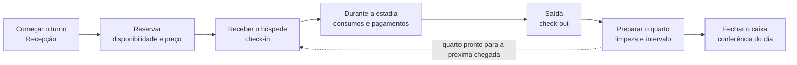

### 1. Começar o turno

A **Recepção** é a tela inicial. Em cima ficam os números do dia. Abaixo, a agenda dos próximos 7 dias aparece ao lado de três abas: **Chegadas**, **Saídas** e **Em risco**.

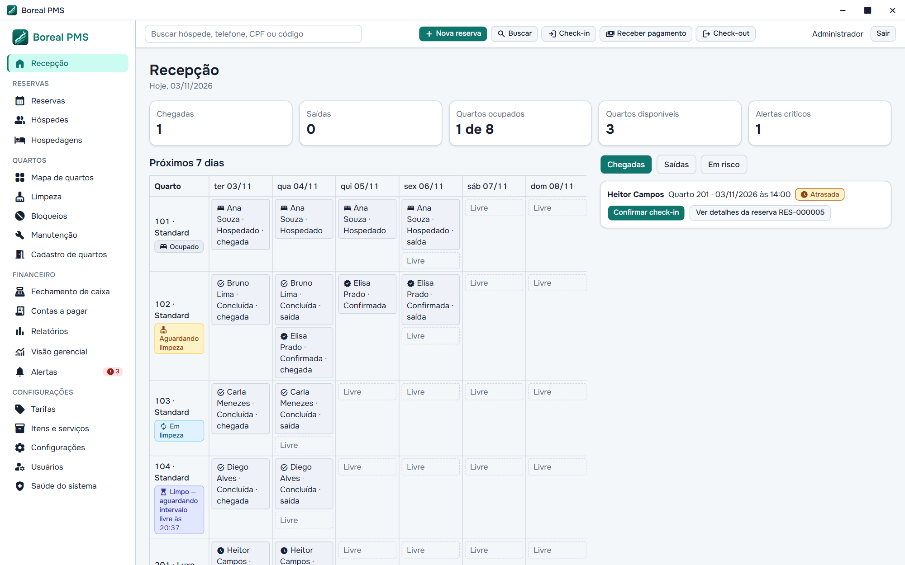

Cada linha já traz a ação principal. Aqui, a chegada do quarto 201 está marcada como **Atrasada**, com texto e ícone, e `Confirmar check-in` está a um clique. O estado nunca depende só da cor.

Ao pedir detalhes, um painel abre **ao lado** da agenda, que continua na tela. É o princípio de preservar o contexto na prática:

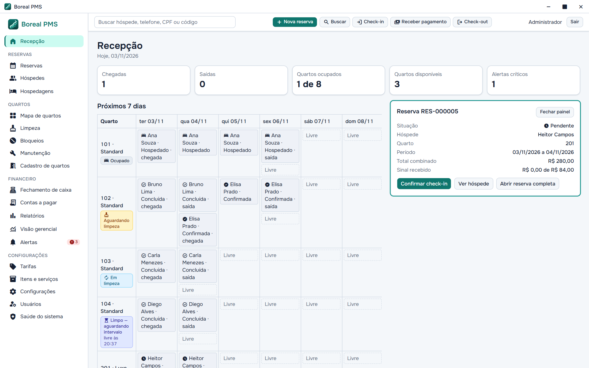

As ações mais comuns têm atalhos: `Alt+N` (nova reserva), `Ctrl+K` (busca), `Alt+C` (check-in), `Alt+R` (receber pagamento) e `Alt+S` (check-out).

**Guia:** [Recepção](usuario/recepcao.md)

### 2. Reservar um quarto

Enquanto a pessoa preenche a reserva, o sistema mostra a disponibilidade e o preço de cada noite, com a regra que gerou aquele valor. A data de saída não gera diária.

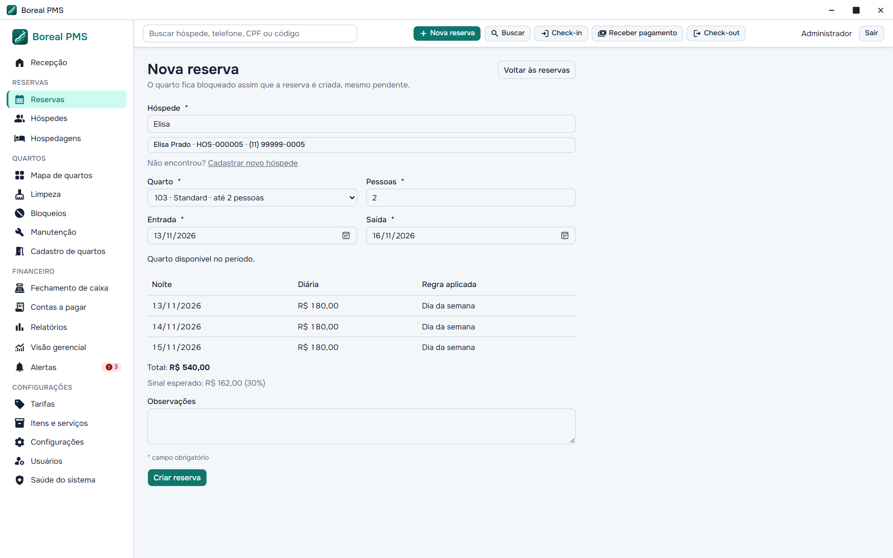

Quando o período não está livre, o sistema não diz apenas "indisponível": ele aponta **o que impede**, e `Criar reserva` fica bloqueado.

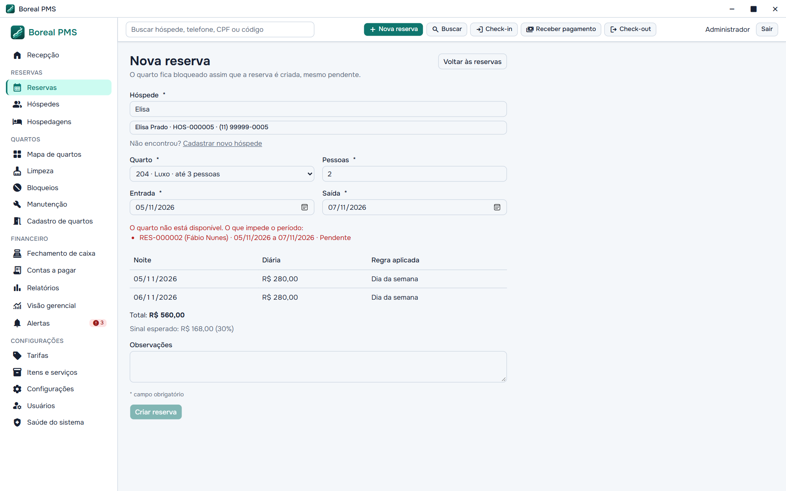

Três regras valem desde a criação:

- **O quarto fica bloqueado assim que a reserva nasce**, mesmo pendente.
- **O preço combinado fica congelado.** Mudar a tabela de tarifas depois não altera a reserva existente.
- **Nada é cancelado sozinho.** Um sinal vencido gera aviso, e quem decide é a recepção.

Alterar datas ou quarto mostra o valor anterior, o novo valor e a diferença. Nada é gravado antes de `Confirmar alteração`.

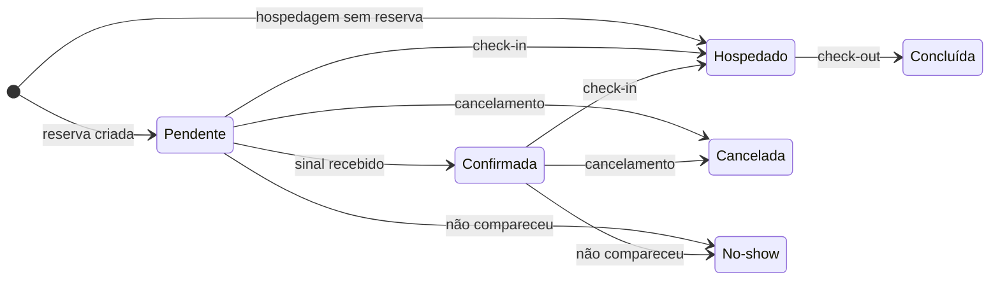

Quem chega sem reserva entra por **Hospedagem sem reserva**. O sistema confere disponibilidade e preço da mesma forma, e o registro recebe um código `AVU-`.

**Guias:** [Reservas](usuario/reservas.md), [Tarifas](usuario/tarifas.md), [Mapa de quartos](usuario/mapa-de-quartos.md)

### 3. Receber o hóspede

`Confirmar check-in` abre a conferência dos ocupantes e do saldo inicial.

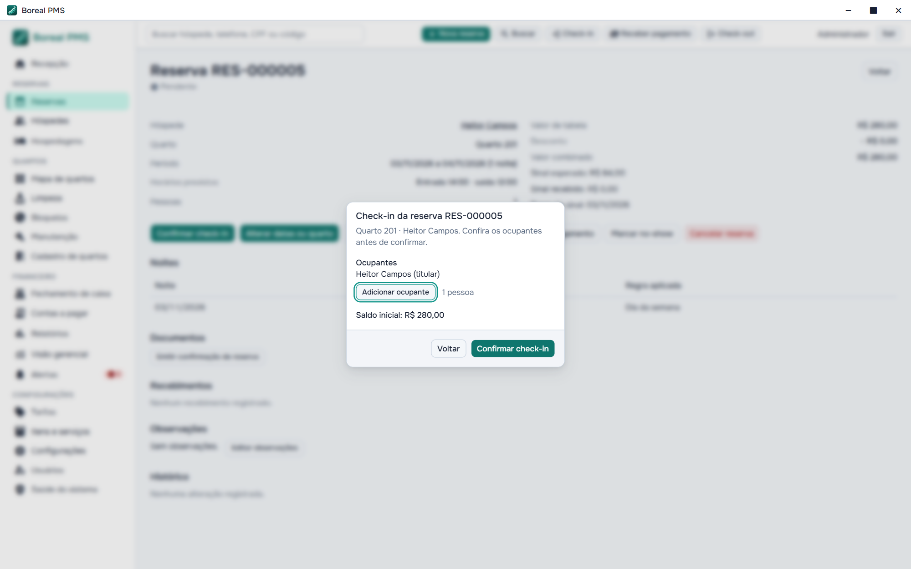

O check-in é o ponto em que várias regras se encontram. O sistema **recusa** o quarto que ainda aguarda limpeza, que está em limpeza ou que não cumpriu o intervalo depois da limpeza. Chegada antes do horário e excesso de capacidade só passam com a permissão correspondente.

Ao confirmar, a hospedagem é criada e as diárias já entram na conta do hóspede, tudo em uma única operação.

**Guia:** [Hospedagem](usuario/hospedagem.md)

### 4. Durante a estadia

A **conta do hóspede** é um livro de lançamentos: diárias, consumos, ajustes e pagamentos, cada um com autor, data e hora.

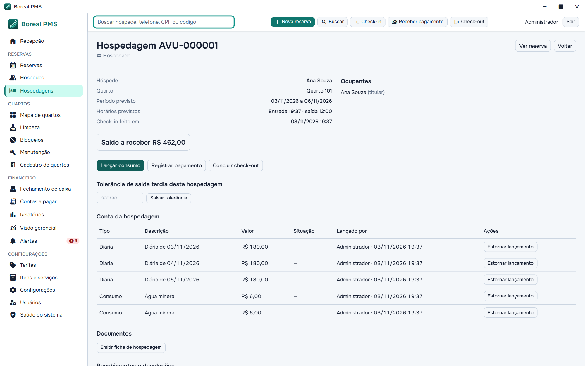

> [!IMPORTANT]
> Um lançamento confirmado nunca é editado nem apagado. Para corrigir, usa-se `Estornar lançamento` e lança-se o valor certo. O original continua no histórico, e o saldo é sempre a soma do livro.

Um pagamento pode ser dividido em mais de uma forma. A soma precisa conferir com o valor recebido; enquanto não conferir, o sistema mostra quanto falta e mantém `Registrar pagamento` bloqueado:

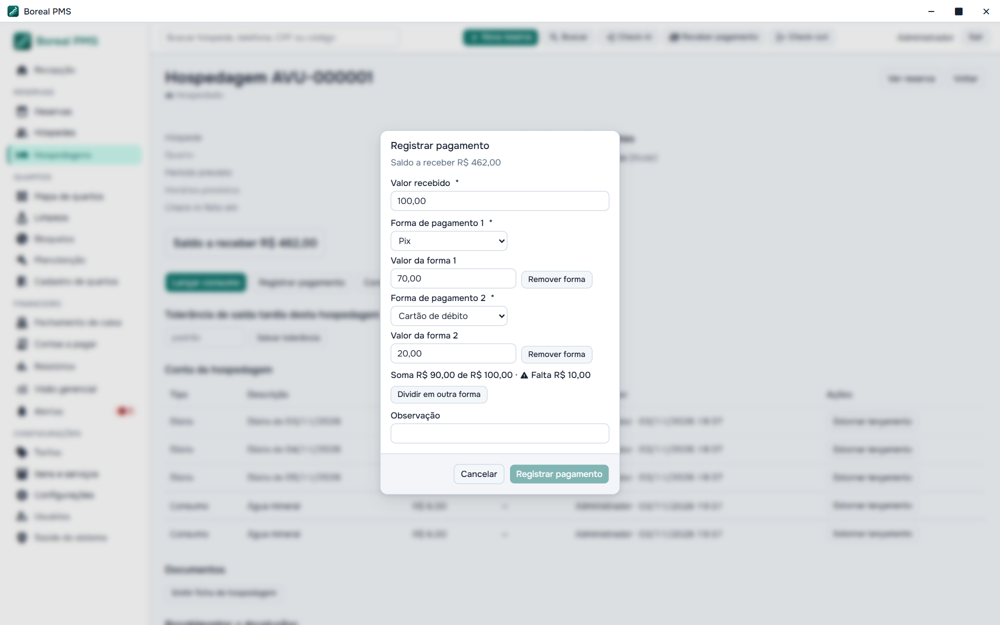

O sistema também avisa sobre um possível recebimento duplicado, e devoluções ficam ligadas ao recebimento original. O registro é manual: o Boreal **não** se conecta a bancos nem a operadoras de cartão.

**Guias:** [Conta do hóspede](usuario/conta-do-hospede.md), [Pagamentos e devoluções](usuario/pagamentos-e-devolucoes.md)

### 5. Saída do hóspede

`Concluir check-out` mostra o demonstrativo com diárias, consumos, descontos, recebimentos, devoluções e saldo. Sair com saldo em aberto é uma exceção: exige permissão e justificativa, e fica registrado quem autorizou.

Se o hóspede passou do horário, o sistema calcula a cobrança de saída tardia, que a recepção cobra ou dispensa. Ele também avisa quando esse atraso encosta na limpeza necessária para a próxima reserva.

Ao concluir, o quarto passa sozinho para **Aguardando limpeza**.

**Guia:** [Hospedagem](usuario/hospedagem.md)

### 6. Preparar o quarto

O estado do quarto nunca é digitado por alguém. Ele é **calculado** a partir dos fatos: se há hóspede, se há bloqueio e em que ponto está a limpeza.

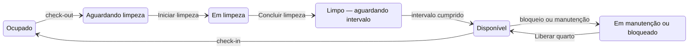

O tempo só avança o último passo. Um quarto sujo nunca fica disponível porque o relógio andou. O **Mapa de quartos** mostra tudo isso de relance, com cor, ícone e nome. Repare no quarto 104, que informa a que horas fica livre:

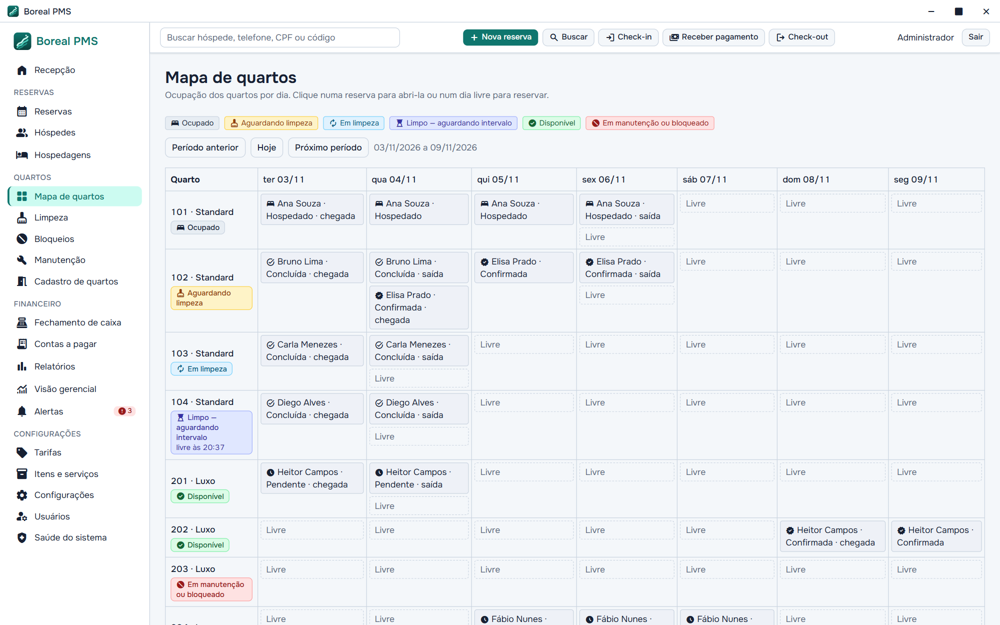

A **Limpeza** é uma fila ordenada por urgência. A prioridade sobe conforme a próxima chegada se aproxima, e pode ser ajustada à mão com justificativa.

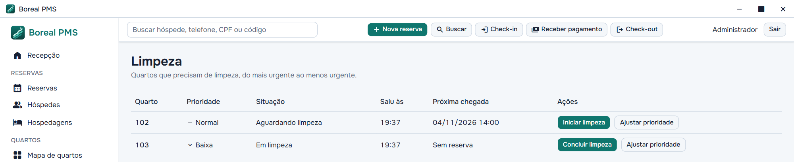

Uma ordem de **manutenção** pode colidir com uma reserva já feita. O Boreal mostra a reserva afetada e impede o início do serviço até alguém resolver a situação. Ele nunca remaneja nem cancela por conta própria. Mesmo com a ordem concluída, o quarto continua bloqueado até alguém autorizado usar `Liberar quarto`.

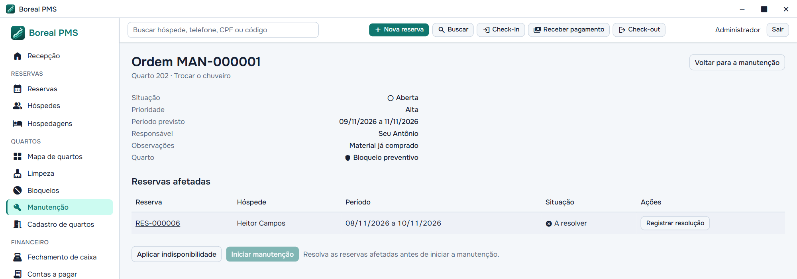

**Guias:** [Limpeza](usuario/limpeza.md), [Bloqueios e manutenção](usuario/bloqueios-e-manutencao.md)

### 7. Fechar o caixa

No fim do dia, a recepção confere o que há em cada forma de pagamento. O sistema calcula o esperado, e a pessoa informa o que contou. Uma diferença não impede o fechamento, mas pede uma justificativa.

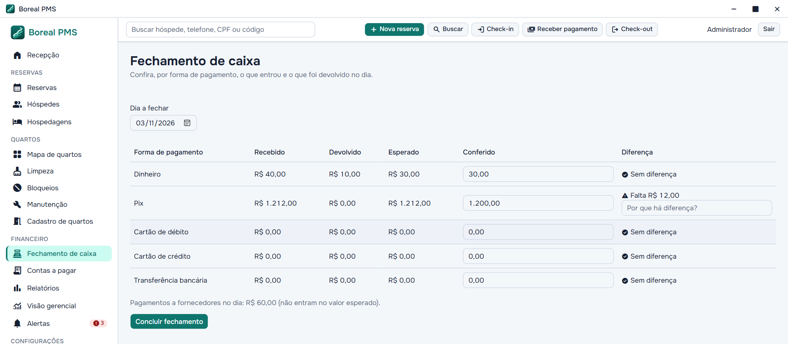

O fechamento não altera nenhum recebimento: ele registra a conferência. Um dia fechado fica somente para leitura, e o que acontecer depois aparece como **Movimentos depois do fechamento**. Concluir o fechamento também dispara um backup automático.

**Guia:** [Fechamento de caixa](usuario/fechamento-de-caixa.md)

## O que acompanha o dia

### Alertas

O que exige atenção fica em **Alertas** até ser resolvido, em ordem de prioridade. Um alerta crítico não pode ser dispensado: ele só some quando o problema acaba. Os demais podem ser dispensados com justificativa, e vão para o histórico com o nome de quem dispensou.

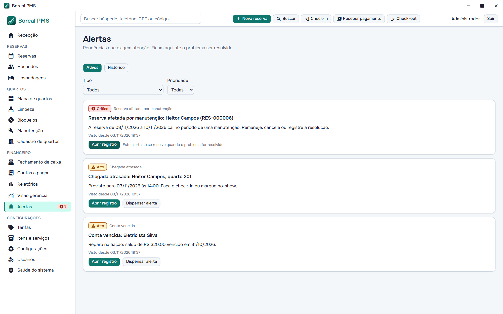

**Guia:** [Alertas](usuario/alertas.md)

### Busca

`Ctrl+K` procura em hóspedes, reservas, hospedagens e movimentos, e cada resultado abre o registro certo. Nomes de hóspedes são encontrados com ou sem acento.

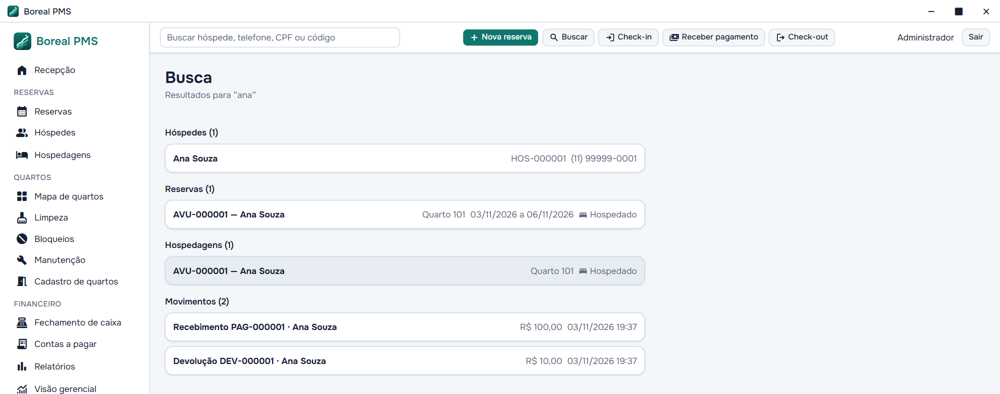

**Guia:** [Busca](usuario/busca.md)

### Visão gerencial e relatórios

A **Visão gerencial**, só para o administrador, reúne ocupação, recebimentos, saldos e contas do período. Cada gráfico tem **Ver os números**, com a tabela equivalente.

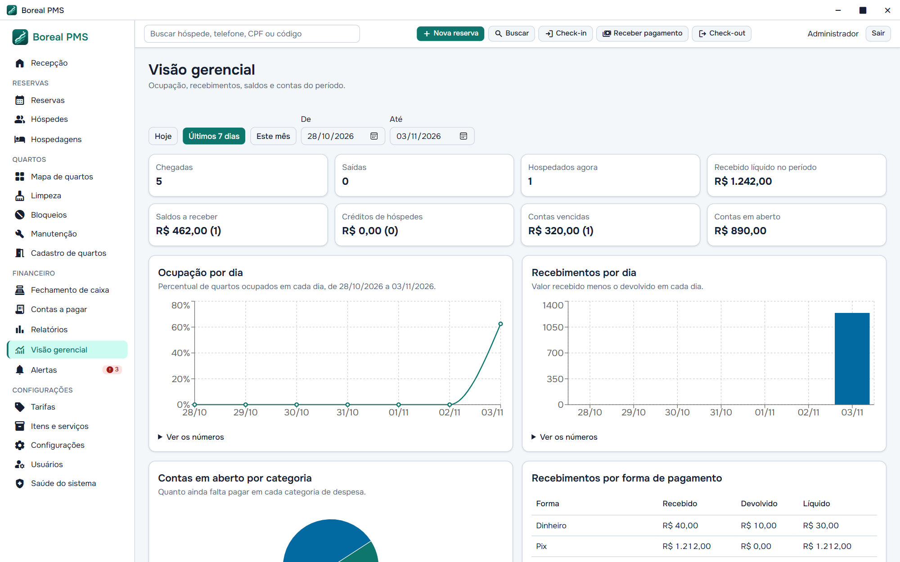

Os **Relatórios** mostram as mesmas linhas na tela, no CSV e no PDF. A recepção vê os quatro operacionais; o administrador vê também os seis financeiros.

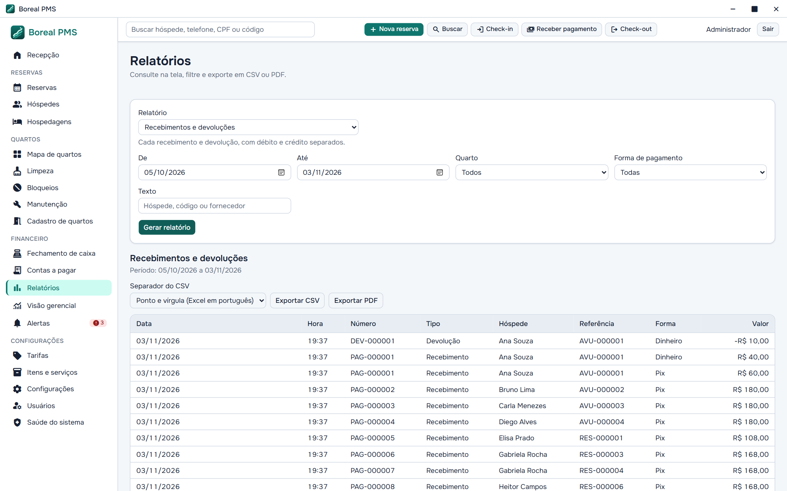

**Guias:** [Visão gerencial](usuario/visao-gerencial.md), [Relatórios](usuario/relatorios.md), [Documentos internos](usuario/documentos.md), [Contas a pagar](usuario/contas-a-pagar.md)

### Permissões

Há dois perfis, **administrador** e **recepção**. A recepção pode receber permissões extras, uma a uma, como dar desconto, estornar ou liberar quarto. Esconder um botão é só conforto de interface: a permissão é sempre conferida de novo no momento de salvar.

**Guia:** [Usuários e permissões](usuario/usuarios.md)

## Proteger os dados

Como tudo vive em um único computador, perder esse computador não pode significar perder a pousada. A tela **Saúde do sistema** reúne essa proteção:

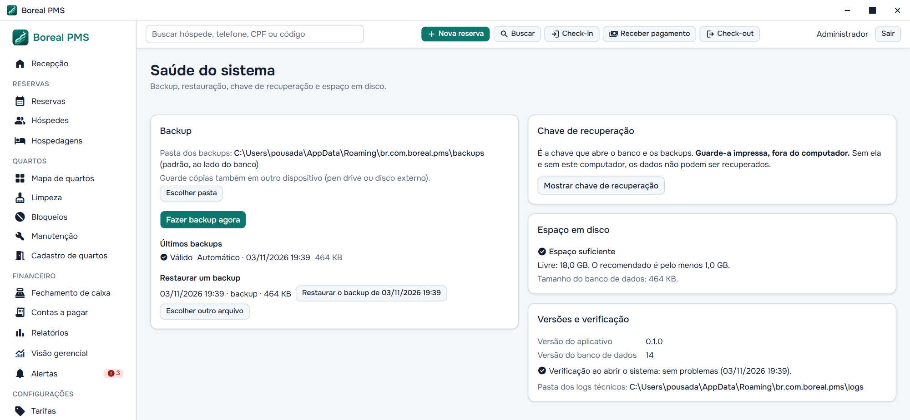

- **Banco criptografado.** A chave fica no cofre de credenciais do Windows, nunca em arquivo.
- **Backup automático.** Roda depois do fechamento de caixa e ao abrir o sistema, se o último tiver mais de 24 horas. Cada cópia é validada antes de valer.
- **Falha de backup não para a recepção,** mas gera um alerta persistente.
- **Chave de recuperação.** É impressa e guardada fora do computador. Sem ela e sem este computador, os dados não podem ser recuperados.
- **Restaurar é deliberado.** Exige digitar `RESTAURAR`, a senha do administrador e faz antes uma cópia de segurança.
- **Trocar de computador** é um fluxo próprio: em uma instalação nova, escolha o backup e digite a chave.

**Guias:** [Backup e restauração](usuario/backup-e-restauracao.md), [Chave de recuperação](usuario/chave-de-recuperacao.md), [Saúde do sistema](usuario/saude-do-sistema.md)

## Como isso se traduz em código

Tudo acima se apoia em uma regra: **a interface nunca é a fonte de verdade**. Ela valida para dar uma boa experiência, e o backend em Rust decide de novo no momento de gravar.

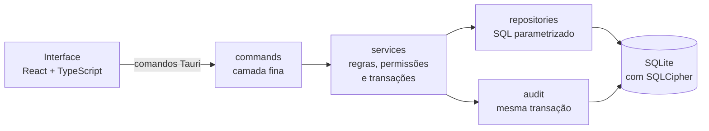

| Regra de produto | Reflexo técnico |
|---|---|
| Não há servidor | A interface fala com o Rust por comandos Tauri. Não existe API HTTP local. |
| Sem gravações parciais | Operações relacionadas usam uma transação, e a auditoria entra nela. |
| Valores exatos | Dinheiro é guardado em centavos inteiros. |
| Datas sem ambiguidade | Datas de calendário e instantes são tratados separadamente; os instantes ficam em UTC. |
| Estado sempre coerente | O estado do quarto é calculado, nunca gravado. |
| Histórico preservado | A auditoria é imutável, garantida por gatilhos no banco. |

Para rodar o projeto, veja o [README](../README.md). Para as decisões técnicas, o ponto de partida é a [documentação de desenvolvimento](desenvolvimento/README.md).

> [!WARNING]
> Vários valores são **provisórios** e configuráveis enquanto aguardam aprovação da pousada, como o sinal de 30%, a cobrança de saída tardia e os prazos de cancelamento. Eles aparecem no [roteiro de treinamento](usuario/roteiro-de-treinamento.md) marcados com ⚠. Não trate esses números como regra fechada.

## Onde aprofundar

| Se você quer… | Vá para |
|---|---|
| Passo a passo de cada tela, na linguagem da equipe | [Manual do usuário](usuario/README.md) |
| Apresentar o sistema para a equipe da pousada | [Roteiro de treinamento](usuario/roteiro-de-treinamento.md) |
| Regras, decisões técnicas e efeitos no banco | [Documentação de desenvolvimento](desenvolvimento/README.md) |
| Popular um banco com dados de exemplo | [Seed de desenvolvimento](desenvolvimento/seed.md) |
| Ver o que mudou | [CHANGELOG](../CHANGELOG.md) |
